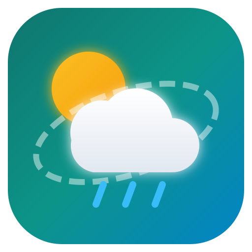

# 🌟 WeatherGuru Gold — ওয়েদার গুরু গোল্ড

<p align="center">
  
</p>

<p align="center">
  <b>WeatherGuru Gold — বাংলাদেশ ও আন্তর্জাতিক আবহাওয়া পূর্বাভাস প্ল্যাটফর্ম</b><br>
  ভিআইপি ফিচার মোড • ৫০+ ভাষা • লাইভ অডিও নোটিফিকেশন • জিপিএস দুর্যোগ সতর্কতা
</p>

<p align="center">
  <a href="https://github.com/shahin134053/WeatherGuro/releases/latest">
    
  </a>
  <a href="https://github.com/shahin134053/WeatherGuro/actions">
    
  </a>
  <a href="https://shahin134053.github.io/WeatherGuro/">
    
  </a>
</p>

---

## 📌 পিন করা অফিসিয়াল রিলিজ: WeatherGuru Gold (Pinned Release)

> 🔗 **অফিসিয়াল গিটহাব রিলিজ পেজ:** [**https://github.com/shahin134053/WeatherGuro/releases/latest**](https://github.com/shahin134053/WeatherGuro/releases/latest)  
> 🌐 **অফিসিয়াল লাইভ ওয়েব অ্যাপ:** [**https://shahin134053.github.io/WeatherGuro/**](https://shahin134053.github.io/WeatherGuro/)

অ্যাপের নাম এবং রিলিজের নাম একই রেখে **WeatherGuru Gold (ওয়েদার গুরু গোল্ড)**-এর অফিসিয়াল প্যাকেজগুলো নিচে পিন করে দেওয়া হলো। এখান থেকে যেকোনো ব্যবহারকারী সরাসরি সর্বশেষ ভার্সনটি ডাউনলোড ও ব্রাউজ করতে পারবেন:

| প্ল্যাটফর্ম (Platform) | ফরম্যাট | সরাসরি ডাউনলোড লিংক (Direct Download Link) | বিবরণ ও ব্যবহার |
| :--- | :--- | :--- | :--- |
| **🤖 Android ফোন/ট্যাব** | `.APK` | [📥 **WeatherGuru-Gold-Android.apk ডাউনলোড করুন**](https://github.com/shahin134053/WeatherGuro/releases/latest/download/WeatherGuru-Gold-Android.apk) | যেকোনো অ্যান্ড্রয়েড ফোনে সরাসরি ইনস্টল করে চালানোর জন্য সম্পূর্ণ রেডি ফাইল (Uptodown, APKPure বা ওয়েবসাইটে পাবলিশের উপযুক্ত)। |
| **🏬 Google Play Store** | `.AAB` | [📦 **WeatherGuru-Gold-PlayStore.aab ডাউনলোড করুন**](https://github.com/shahin134053/WeatherGuro/releases/latest/download/WeatherGuru-Gold-PlayStore.aab) | গুগল প্লে কনসোলের জন্য অফিসিয়াল প্রোডাকশন বান্ডেল (Google Play 64-bit ও Target SDK কমপ্লায়েন্ট)। |
| **🍎 iPhone / iPad (iOS)** | `.ZIP` | [🍏 **WeatherGuru-Gold-iOS.zip ডাউনলোড করুন**](https://github.com/shahin134053/WeatherGuro/releases/latest/download/WeatherGuru-Gold-iOS.zip) | Apple iPhone-এর জন্য সম্পূর্ণ Capacitor iOS প্রজেক্ট ফাইল (Xcode ও TestFlight-এ বিল্ডের উপযোগী)। |
| **🌐 ইনস্ট্যান্ট ওয়েব PWA (লাইভ)** | Web App | [🚀 **WeatherGuru Gold সরাসরি চালান (GitHub Pages)**](https://shahin134053.github.io/WeatherGuro/) | কোনো কিছু ডাউনলোড না করে ফোনের ব্রাউজার থেকে সরাসরি লাইভ অ্যাপ চালানো এবং হোম স্ক্রিনে যুক্ত করার সুবিধা। |

> 💡 **স্বয়ংক্রিয় আপডেট নোট:** উপরের ডাউনলোড লিংকগুলো গিটহাবের ডাইনামিক `releases/latest/download` রাউটে পিন করা। তাই পরবর্তীতে প্রতিটি আপডেটে স্বয়ংক্রিয়ভাবে সর্বদা **WeatherGuru Gold-এর সবচেয়ে লেটেস্ট ভার্সনটাই** ডাউনলোড হবে।

---

### 📱 কীভাবে ফোনে ইনস্টল করবেন?

#### অ্যান্ড্রয়েড (Android) ব্যবহারকারীদের জন্য:
1. উপরে থাকা [**WeatherGuru-Gold-Android.apk ডাউনলোড করুন**](https://github.com/shahin134053/WeatherGuro/releases/latest/download/WeatherGuru-Gold-Android.apk) লিংকে ক্লিক করুন।
2. ফাইলটি ডাউনলোড শেষ হলে আপনার ফোনের নোটিফিকেশন বা ফাইল ম্যানেজার থেকে ফাইলটি ওপেন করুন।
3. ফোনে যদি প্রথমবারের মতো অনুমতি চায়, তবে *"Allow from this source"* দিয়ে **Install** বাটনে চাপুন।
4. ইনস্টল শেষ হওয়া মাত্রই **WeatherGuru Gold** অ্যাপটি আপনার ফোনে পুরোদমে কাজ করবে!

#### আইফোন (iPhone / iOS) ব্যবহারকারীদের জন্য:
1. আইফোনের **Safari** ব্রাউজারে [**https://shahin134053.github.io/WeatherGuro/**](https://shahin134053.github.io/WeatherGuro/) লিঙ্কটি ওপেন করুন।
2. নিচের **Share** আইকনে (বক্স ও উপরের তীর চিহ্ন) চাপুন।
3. তালিকা থেকে **"Add to Home Screen"** সিলেক্ট করুন।
4. আপনার আইফোনের অ্যাপলিস্টে **WeatherGuru Gold** যুক্ত হয়ে যাবে এবং নেটিভ অ্যাপের মতো ফুলস্ক্রিন চলবে।

---

## ✨ WeatherGuru Gold-এর মূল ফিচারসমূহ

1. **📍 স্বয়ংক্রিয় জিপিএস ও দেশভিত্তিক বার্তা:** অ্যাপ ওপেন করা মাত্রই ইউজার যে দেশে বা শহরে অবস্থান করছেন, সেখানকার আবহাওয়া বার্তা ও সতর্কবার্তা চলে আসে।
2. **🔊 লাইভ অডিও ভয়েস নোটিফিকেশন (TTS):** প্রতিটি আবহাওয়া কার্ড ও সতর্কবার্তায় অডিও বাটন—পড়তে না পারলেও এক ক্লিকে স্পষ্ট বাংলা বা ইংরেজি কণ্ঠে বার্তা শুনে নেওয়ার সুবিধা।
3. **⚠️ দুর্যোগ ও বিপদ সংকেত অ্যালার্ট:** ঘূর্ণিঝড়, বজ্রপাত, কালবৈশাখী বা তীব্র তাপপ্রবাহে জিপিএসের মাধ্যমে তাৎক্ষণিক পপআপ ও নোটিফিকেশন বার্তা।
4. **🚢 নদীবন্দর ও সমুদ্র সংকেত:** নদীবন্দর ও সমুদ্রের জন্য ১ থেকে ১০ নম্বর সতর্ক সংকেত এবং লঞ্চ/জাহাজ চলাচলে নিষেধাজ্ঞা সতর্কতা।
5. **🚆 ফ্লাইট, ট্রেন ও সড়ক ট্রানজিট নিরাপত্তা:** বৃষ্টি ও ঘন কুয়াশায় ফ্লাইট বা ট্রেন বিলম্বে পড়ার সম্ভাব্য ঝুঁকি পূর্বাভাস।
6. **🌾 কৃষি ও প্রকৃতি হাব:** কৃষকদের জন্য উপযুক্ত ফসল পরিচর্যা, বালাই ব্যবস্থাপনা এবং জোয়ার-ভাটা ও চন্দ্রকলার পূর্ণাঙ্গ ক্যালেন্ডার।
7. **🌍 বিশ্বের শীর্ষ দূষিত ও পরিবেশবান্ধব শহর:** প্রতি মাসে স্বয়ংক্রিয়ভাবে আপডেট হওয়া বিশ্বসেরা পরিবেশবান্ধব এবং শীর্ষ দূষিত শহরের তালিকা ও ইউজারের দেশের র‍্যাঙ্কিং।
8. **🌐 ৫০+ আন্তর্জাতিক ভাষা ও RTL সাপোর্ট:** বাংলা, ইংরেজি, আরবি (العربية), স্প্যানিশ (Español), জার্মান (Deutsch), ফরাসি (Français) ইত্যাদি।

---

## 🛠️ ডেভেলপার ও লোকাল বিল্ড

```bash
# ডিপেনডেন্সি ইনস্টল
npm install --legacy-peer-deps

# ডেভেলপমেন্ট সার্ভার চালু
npm run dev

# প্রোডাকশন বিল্ড
npm run build
```

---

<p align="center">
  <b>WeatherGuru Gold (ওয়েদার গুরু গোল্ড)</b><br>
  ডেভেলপার: <b>Md Shahin</b> | Pixel Retouch Pro (PRP)<br>
  অফিশিয়াল গিটহাব: <a href="https://github.com/shahin134053/WeatherGuro">github.com/shahin134053/WeatherGuro</a>
</p>
